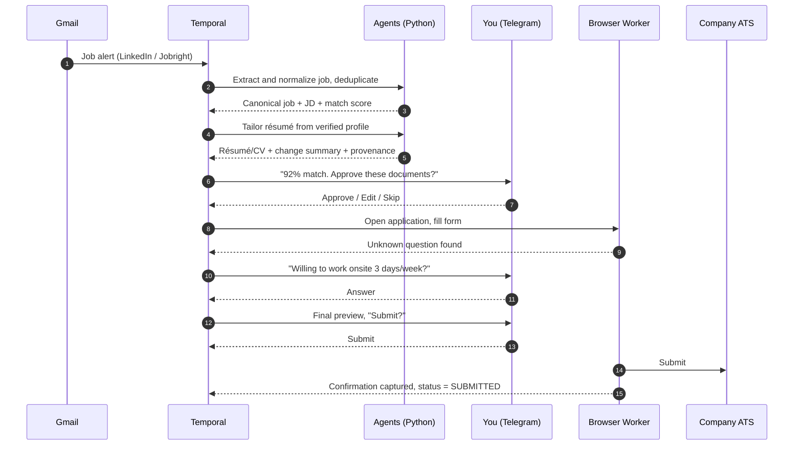
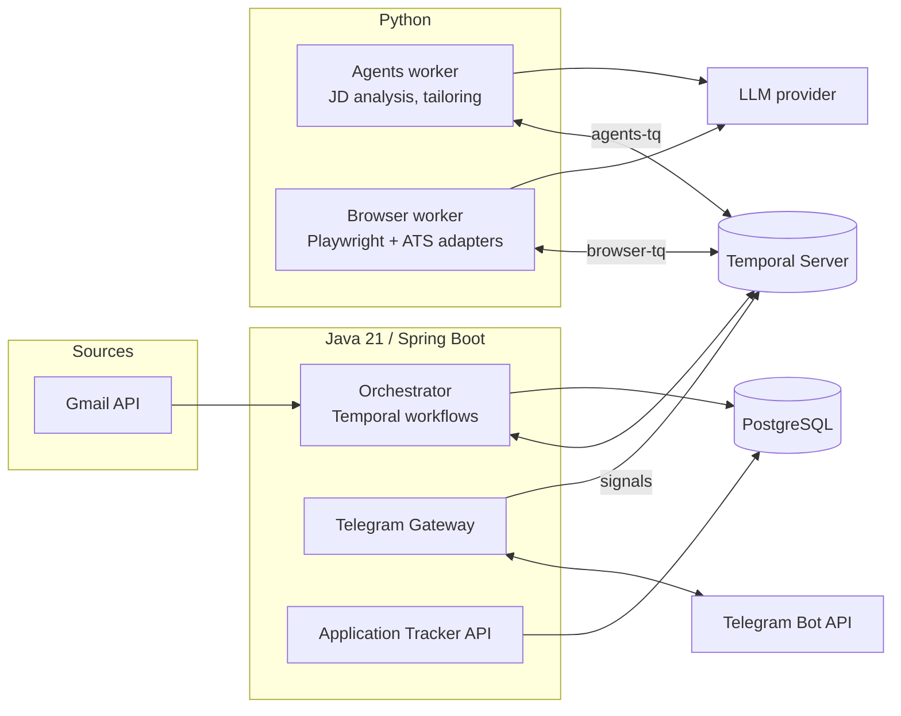

# ApplyOps

> **Automate the process. Own the decisions.**

ApplyOps is an agentic job-application platform with a human in the loop. It finds jobs in your email alerts, tailors your résumé to each job description using only facts from your verified career profile, asks you to approve over Telegram, fills in the application form with a browser agent, and sends any question it can't answer back to you. Every application runs as its own durable Temporal workflow, so the system can wait days for your reply, survive crashes, and never submit the same application twice.

> **Status: M1 (job discovery) in progress.** Gmail → parse → dedup → one workflow per job is built and tested; waiting on real mailbox validation. See [Design](docs/DESIGN.md), [Roadmap](docs/ROADMAP.md) and the [ADRs](docs/adr/).

## Quick start

Requires Docker, Java 21 and Python 3.12+.

```bash
make up       # Postgres, Temporal, Temporal UI, Java orchestrator, Python agents worker
make smoke    # HelloWorkflow (Java) -> echo activity (Python) -> result
make gmail-auth  # one-time: read-only Gmail consent (needs data/gmail-credentials.json)
make discover    # run one job-discovery pass; make jobs shows results
make test     # Java + Python unit and schema-contract tests
make down     # stop (make clean also deletes volumes)
```

Temporal UI: http://localhost:8080

---

## Why

Applying to jobs is repetitive, but the important decisions shouldn't be automated away. Existing auto-apply tools either spray low-quality applications or ask you to trust a black box that may invent experience. ApplyOps takes the opposite approach:

- **Deterministic where possible, AI only where needed.** You don't need an LLM to check whether you already applied. A unique constraint does that.
- **The orchestrator owns the state; agents just do tasks.** No LLM decides "what happens next" in the workflow.
- **You approve everything that leaves your hands.** Documents and final submission both need an explicit approval.

The first user is the author, who uses it daily for a real job search and measures how well it works.

## How it works



## Architecture



| Component | Responsibility |
|---|---|
| **Orchestrator** (Java) | Temporal workflow definitions: job discovery and the per-application lifecycle |
| **Gmail Ingestor** (Java step) | Incrementally reads alert emails, extracts job links |
| **Agents worker** (Python) | JD extraction/analysis, match scoring, grounded résumé/CV tailoring |
| **Browser worker** (Python) | Playwright: ATS-specific adapters first, bounded LLM fallback |
| **Telegram Gateway** (Java) | Sends approval/question messages; turns button taps and replies into workflow signals |
| **Application Tracker** (Java) | Postgres-backed record of jobs, applications, documents, Q&A |
| **Temporal UI** | Live view of every application workflow and its state |

## Guardrails (non-negotiable)

1. **No automation of LinkedIn or other platforms that forbid it.** LinkedIn/Jobright are used only for *discovery* through the emails they send you. We apply through the company's ATS (Greenhouse, Lever, Ashby, …). See [ADR-0003](docs/adr/0003-discovery-via-email-apply-via-ats.md).
2. **No CAPTCHA or bot-detection bypass.** If we hit one, the workflow pauses as `NEEDS_MANUAL` and pings you.
3. **Human approval before every submission.** See [ADR-0005](docs/adr/0005-human-approval-before-submit.md).
4. **No invented experience.** Every résumé line must trace back to an entry in your verified `profile.yaml`. See [ADR-0004](docs/adr/0004-grounded-resume-tailoring.md).
5. **Job descriptions are untrusted input.** Agents run with whitelisted tools; JD text can't trigger actions.

## Tech stack

| Concern | Choice |
|---|---|
| Workflow engine | Temporal ([ADR-0001](docs/adr/0001-temporal-as-orchestrator.md)) |
| Core backend | Java 21 + Spring Boot, Temporal Java SDK |
| Agents / browser | Python 3.12, Temporal Python SDK, Playwright ([ADR-0002](docs/adr/0002-java-python-polyglot-workers.md)) |
| Persistence | PostgreSQL + Flyway |
| Discovery | Gmail API (OAuth, read-only scope) |
| Human interaction | Telegram Bot API |
| Documents | DOCX templating → PDF |
| Local deploy | Docker Compose |
| CI | GitHub Actions |
| Observability | Temporal UI, structured logs; OpenTelemetry later |

Deliberately **not** in v1: Kafka, Kubernetes, Redis, a vector DB. We'll add them only when a real need shows up.

## Repository layout (target)

```
applyops/
├── orchestrator/        # Java: Temporal workflows, Gmail ingestor, tracker API
├── telegram-gateway/    # Java: Telegram bot ↔ Temporal signals
├── agents/              # Python: JD analysis, résumé tailoring, validators
├── browser-worker/      # Python: Playwright, ATS adapters, LLM fallback
├── profile/             # profile.schema.json (+ your private profile.yaml, gitignored)
├── evals/               # Tailoring truthfulness + form-fill eval sets
├── infra/               # docker-compose, Temporal/Postgres config
└── docs/                # Design, roadmap, ADRs
```

## MVP success criteria

- [ ] Discover 100 jobs from Gmail notifications
- [ ] Deduplicate jobs across LinkedIn and Jobright
- [ ] Generate tailored résumés with zero unsupported claims on the eval set
- [ ] Approve documents and answer questions through Telegram
- [ ] Apply on Greenhouse, Lever and Ashby (where automation is allowed)
- [ ] Recover from worker crashes without losing progress
- [ ] Zero duplicate submissions under retries and crash injection
- [ ] Docker Compose deploy with automated tests in CI
- [ ] Five real users give feedback

## Docs

- [Design](docs/DESIGN.md): components, workflows, state machine, data model, reliability, security
- [Roadmap](docs/ROADMAP.md): milestones M0–M6 with acceptance criteria
- [ADRs](docs/adr/): architecture decision records
