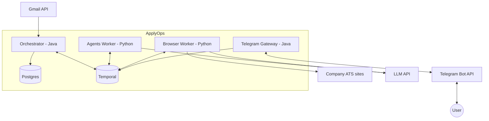
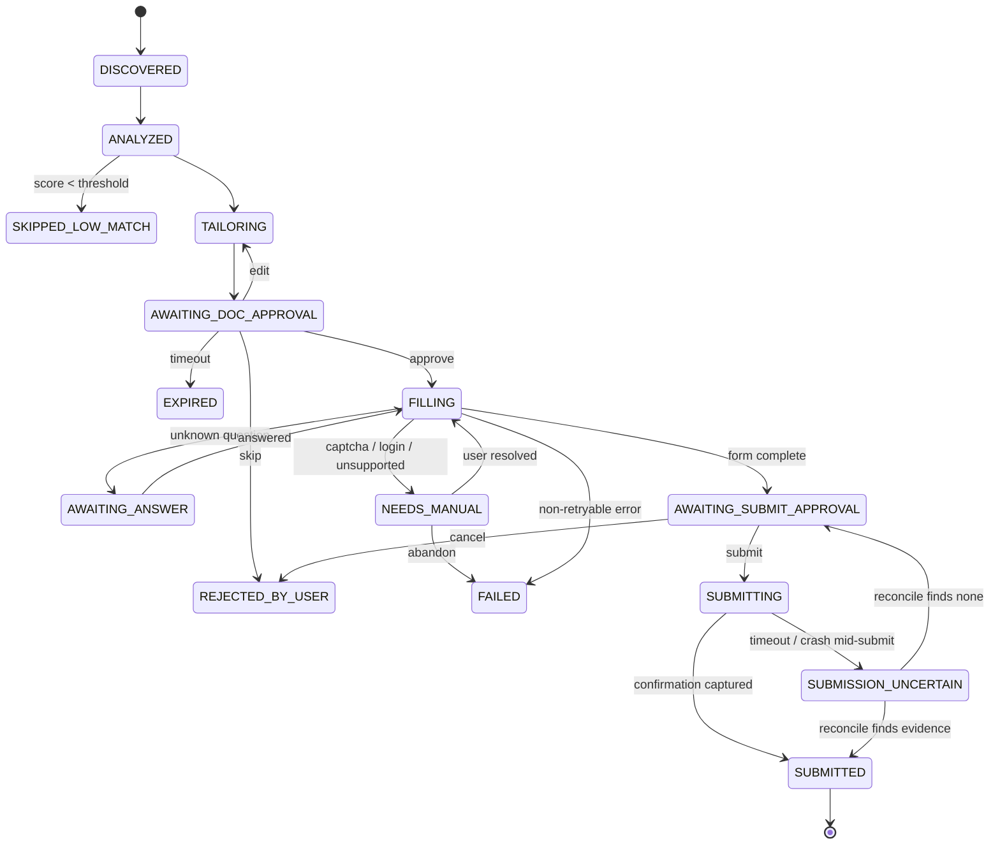

# ApplyOps — System Design

Status: **Draft v0.1** · Last updated: 2026-11-18

## 1. Goals and non-goals

**Goals**
- Find relevant jobs from email alerts automatically, with no duplicates across sources.
- Produce tailored résumé/CV documents that are **provably grounded** in the user's verified history.
- Keep the human in control: approvals and answers over Telegram, from anywhere.
- Fill and submit applications on common ATS platforms through a browser agent.
- Make every application a durable, observable, resumable workflow.
- Run exactly one submission per job, even under retries and crashes.

**Non-goals (v1)**
- Multi-user SaaS, billing, or a public sign-up. (Single user; designed so multi-tenant is possible later.)
- Automating LinkedIn Easy Apply or any site whose terms forbid automation.
- Bypassing CAPTCHA, bot detection, or interactive login/MFA.
- Fully unattended submission.

## 2. System context



### Component responsibilities

| Component | Runtime | Owns | Does NOT do |
|---|---|---|---|
| **Gmail Ingestor** | Java step | Incremental fetch by Gmail `historyId`; parsing LinkedIn/Jobright alert templates into job links | Fetch JDs, apply |
| **Job Normalizer / Dedup** | Java step | Resolving redirect links to the final ATS URL; computing `canonical_key`; upserting `job` | LLM calls |
| **JD Analyzer** | Python step | Fetching JD page → structured `JobSpec` (title, company, location, requirements, salary); match score against the profile | Decide workflow flow |
| **Résumé Tailor** | Python step | Selecting and rephrasing profile entries → structured résumé JSON → provenance validation → DOCX/PDF render + change summary | Invent facts |
| **Telegram Gateway** | Java service | Outbound messages, inline buttons, inbound callbacks → Temporal signals; auth by chat allowlist | Hold workflow state |
| **Browser Worker** | Python step | Playwright sessions; ATS adapters; bounded LLM fallback for unknown fields; screenshots | Submit without an approval token |
| **Application Tracker** | Java (Spring) | REST API + DB projection of all applications for dashboards/queries | Be the source of truth for in-flight state (Temporal is) |
| **Temporal** | Server | Durable execution state, timers, signals, retries, history | — |

**Source of truth:** Temporal workflow history is authoritative for *in-flight* state. Postgres is a projection that workflow steps write to, used for queries, dedup constraints and long-term history.

## 3. Workflows

### 3.1 `JobDiscoveryWorkflow` (scheduled)
Run by a Temporal Schedule every N minutes (default 15).

1. `fetchNewAlertEmails(lastHistoryId)` → list of messages since the last checkpoint (Gmail `users.history.list`; full re-sync fallback if `historyId` has expired).
2. For each message: `parseAlert(message)` → job links (provider-specific parsers: `LinkedInAlertParser`, `JobrightAlertParser`).
3. `resolveAndNormalize(link)` → `{atsType, atsUrl, canonicalKey}`.
4. `upsertJob(...)` — `INSERT ... ON CONFLICT (canonical_key) DO NOTHING`; adds a `job_source` row either way.
5. For **newly inserted** jobs only: start `ApplicationWorkflow` with `workflowId = "app-" + canonicalKey` and `WorkflowIdReusePolicy = REJECT_DUPLICATE`. Starting the same job again is a no-op. This is the first layer of dedup.
6. Save the new `historyId` checkpoint.

### 3.2 `ApplicationWorkflow` (one per canonical job)

```text
analyze → (score < threshold ? SKIPPED_LOW_MATCH)
       → tailor → requestDocApproval ⟶ await signal (timeout 72h → EXPIRED)
           approve → fill
           edit(text) → re-tailor with instructions → requestDocApproval
           skip → REJECTED_BY_USER
       → fill loop:
           browser.fillForm() returns {status: READY | NEEDS_ANSWERS | BLOCKED}
           NEEDS_ANSWERS → for each question: answer_memory hit? use it : ask user (signal)
           BLOCKED (captcha/login) → NEEDS_MANUAL, wait for "done/retry/abandon" signal
       → requestSubmitApproval (with screenshot of the final review page) → await signal
       → submit (idempotent, see §9) → SUBMITTED | SUBMISSION_UNCERTAIN → reconcile
```

- **Signals:** `docDecision(requestId, decision, editText?)`, `answer(requestId, questionId, text)`, `submitDecision(requestId, decision)`, `manualResolved(requestId, action)`.
- **Queries:** `getState()` returns current state + pending human request, used by the tracker and the Telegram `/status` command.
- **Timers:** each human request has an expiry; on expiry the workflow sends one reminder, then moves to `EXPIRED`. It can be revived with `/resume <job>`.
- Waiting workflows **use no worker threads**. Temporal keeps them in history and evicts them from worker cache, so 100 or 10,000 pending approvals cost nothing but storage.
- Long-running: use `continueAsNew` if the Q&A loop history grows large (unlikely per application).

### 3.3 Task queues (Java ↔ Python)

| Task queue | Worker | Activities |
|---|---|---|
| `orchestrator-tq` | Java | workflows, Gmail, normalize, DB writes, Telegram send |
| `agents-tq` | Python | `analyzeJob`, `tailorDocuments`, `validateProvenance`, `renderDocuments` |
| `browser-tq` | Python | `fillForm`, `applyAnswers`, `captureReview`, `submit`, `checkSubmissionStatus` |

Data passed between languages is **JSON with versioned schemas** (`JobSpec v1`, `TailoredResume v1`, `FormState v1`), defined once in `schemas/` as JSON Schema. Java records and Python Pydantic models are generated or validated from them. Big binary data (PDFs, screenshots) goes in a local blob store (filesystem / MinIO later). Only the paths go through Temporal; payloads are never inlined into history.

Browser worker concurrency: `maxConcurrentActivityExecutionSize = 2` (configurable) to limit memory and avoid hammering sites.

## 4. Application state machine



Future (post-MVP): `SUBMITTED → RECRUITER_REPLIED → INTERVIEWING → OFFER | REJECTED`, driven by classifying incoming Gmail.

## 5. Data model (Postgres)

```sql
job (
  id               uuid pk,
  canonical_key    text unique not null,   -- e.g. "greenhouse:acme:4012345"
  ats_type         text,                   -- greenhouse | lever | ashby | workday | unknown
  ats_url          text,
  company          text, title text, location text,
  jd_text          text, jd_spec jsonb,    -- structured JobSpec
  match_score      numeric,
  first_seen_at    timestamptz
)
job_source (job_id fk, provider text, external_id text, email_message_id text, seen_at,
            unique(provider, external_id))
application (
  id uuid pk, job_id fk unique,            -- one application per job
  workflow_id text unique, state text, state_changed_at timestamptz,
  submitted_at timestamptz, confirmation_ref text, idempotency_key text unique
)
document_version (id, application_id fk, kind text /*resume|cover_letter*/, version int,
                  content_json jsonb, provenance jsonb, file_path text, approved bool, created_at)
human_request (
  id uuid pk, application_id fk, kind text /*doc_approval|question|submit_approval|manual*/,
  payload jsonb, status text /*pending|answered|expired|superseded*/,
  telegram_message_id bigint, expires_at, answered_at, response jsonb
)
answer_memory (id, question_norm text, question_embedding? (later), answer text,
               scope text /*global|company*/, last_used_at)   -- reusable answers
event_log (id, application_id, at, type, data jsonb)   -- append-only audit trail
```

**Verified career profile:** `profile.yaml` (gitignored, validated by `profile/profile.schema.json`). Every experience bullet, skill, project and education entry has a stable `id`. This file is the **only** factual source the tailor can use.

```yaml
contact: { name: ..., email: ..., phone: ..., location: ..., links: [...] }
work_authorization: { country: US, status: ..., needs_sponsorship: false }
experience:
  - id: flow-1
    company: Flow
    title: Senior Software Engineer
    start: 2022-03
    bullets:
      - id: flow-1-b1
        text: Built workflow orchestration for approvals across N integrations...
        skills: [java, kestra, distributed-systems]
        metrics: { ... }
skills: [...]
preferences: { min_salary: ..., remote: hybrid_ok, locations: [...], exclude_companies: [...] }
standard_answers: { willing_to_relocate: ..., notice_period: ..., ... }
```

## 6. Telegram interaction design

**Message types**
| Type | Content | Actions |
|---|---|---|
| Doc approval | Job title/company/salary/match %, 3–5 bullet change summary, PDF attachment | `Approve` · `Edit` · `Skip` · `View diff` |
| Question | ATS question text, field type, options (if select), suggested answer if any | Option buttons, or free-text reply · `Save as default` toggle |
| Submit approval | Screenshot of the review page + filled-field summary | `Submit` · `Cancel` |
| Manual needed | Reason (CAPTCHA/login), link | `Done, retry` · `Abandon` |
| Info | Submitted / failed / daily digest | — |

**Correlation and safety**
- Callback data = `v1:<requestId>:<action>:<hmac>`. Telegram limits callback data to 64 bytes, so it carries the short `requestId` and an HMAC; the gateway looks up `workflowId` from `human_request`.
- Free-text replies are tied to a request through Telegram's *reply-to* (`telegram_message_id`), or with ForceReply.
- **Authorization:** only allowlisted `chat_id`s are accepted; everything else is dropped and logged.
- **Idempotency:** the gateway checks `human_request.status = pending` before signalling (a conditional update). Duplicate taps or Telegram retries are ignored. Workflows also ignore signals whose `requestId` doesn't match the current pending request (stale or superseded).
- **Expiry:** expired requests answer "This request expired; use /resume".
- Transport: long polling in v1 (no public endpoint needed); webhook later.
- Commands: `/status`, `/pending`, `/pause`, `/resume <job>`, `/skip <job>`.

## 7. Résumé tailoring (grounded generation)

1. **Select:** given `JobSpec` and `profile.yaml`, the LLM returns *IDs* of the bullets/skills/projects to include and their order. (Structured output, constrained to existing IDs.)
2. **Rephrase:** for each selected bullet, the LLM may rewrite the wording to match JD vocabulary. Output: `{bullet_id, text}`.
3. **Validate provenance** (deterministic + LLM judge):
   - Every output item must reference a valid profile ID.
   - Numbers, company names, titles, dates and technologies in the rewritten text must appear in the source bullet or the profile skill list (regex/entity check).
   - An LLM-judge entailment check ("Does the source support the rewrite?"); items that fail are reverted to the original text.
4. **Render:** fill a DOCX template (python-docx / docxtpl) → PDF (LibreOffice headless).
5. **Summarize changes:** a diff against the base résumé → 3–5 human-readable bullets for Telegram.
6. **Eval suite** (`evals/tailoring/`): fixed JDs + profile → assert 0 unsupported claims, coverage of JD keywords, page-length limit.

Cover letters follow the same pattern: claims must cite profile IDs; free prose only for connecting sentences.

## 8. Browser agent

**Adapter-first, LLM-fallback.**

```text
fillForm(job, docs, answers):
  adapter = registry.get(job.ats_type)        # GreenhouseAdapter, LeverAdapter, AshbyAdapter
  if adapter: fields = adapter.extract_fields(page)
  else:       fields = llm_field_extractor(accessibility_tree)   # bounded fallback
  for field in fields:
     value = resolve(field)   # profile → standard_answers → answer_memory → None
  unresolved = [f for f in fields if value is None]
  if unresolved: return NEEDS_ANSWERS(unresolved)
  adapter.fill(page, values); upload docs
  return READY(review_screenshot)
```

- **Bounded tools for the LLM fallback:** `read_accessibility_tree`, `fill(selector, value)`, `select(selector, option)`, `upload(selector, file)`, `click(selector)`. Only within the application origin, and the click tool **refuses** elements matching submit patterns. Submit is a separate step that needs a valid approval token.
- **Sessions:** a fresh Playwright `BrowserContext` per application (isolated cookies), persisted to disk as `storageState` so a fill can resume after a crash or a 24h wait. Recover by reloading the URL and re-filling, since filling is idempotent.
- **Detection:** CAPTCHA / login wall / unsupported flow → return `BLOCKED(reason)`; never try to get around it.
- **Evidence:** a screenshot + HTML snapshot at each step, stored by `application_id`.
- **Politeness:** per-domain rate limiting, a real user agent, no parallel sessions against the same domain.

## 9. Reliability

| Risk | Mitigation |
|---|---|
| Same job from LinkedIn and Jobright | Resolve to the final ATS URL → `canonical_key`; `job.canonical_key UNIQUE`; workflowId = `app-<canonicalKey>` with REJECT_DUPLICATE |
| Gmail poll re-reads messages | `historyId` checkpoint + `job_source(provider, external_id)` unique |
| Worker crash mid-workflow | Temporal replays history; completed steps aren't re-run; the browser fill step is idempotent and re-runs from scratch |
| **Crash or timeout during submit** | Submit step has `maximumAttempts = 1`. On failure or timeout → `SUBMISSION_UNCERTAIN` → `checkSubmissionStatus` (look for the confirmation page in a new session, or a confirmation email in Gmail) → only re-ask for submit approval if there's no evidence. **Never retry the submit blindly.** |
| Duplicate submission via a race | `application.idempotency_key` = hash(job, doc version); the submit step does a conditional DB update `state: SUBMIT_APPROVED → SUBMITTING` before clicking; if it fails, abort |
| User approves two days later | Durable timers/signals; no resources held |
| Stale approval (docs changed after the request was sent) | `requestId` per version; superseded requests are rejected |
| LLM/API outage | Step retries with exponential backoff; non-retryable error types for validation failures |
| Website layout change | Adapter contract tests against saved HTML fixtures; fallback to LLM extraction; else `NEEDS_MANUAL` |

**Crash-recovery walkthrough.** 20 in-flight applications, laptop dies. On restart: Temporal server state is in Postgres → workers reconnect → workflows waiting on signals stay waiting (no-op) → steps that were running time out (via heartbeat timeout) and are retried. The only exception is `submit`, which goes to reconciliation. No progress is lost and nothing is double-submitted.

## 10. Security and privacy

- **Secrets:** Gmail OAuth refresh token, Telegram bot token, LLM key in `.env` (gitignored) for local; Docker secrets / SOPS later. Gmail scope is `gmail.readonly`.
- **Prompt injection:** JD text and page content are wrapped as untrusted data in prompts; agents have no access to tools that send messages, email, or submit. Tool calls are checked against an allowlist and an origin restriction; the submit step needs a signed approval token that only the workflow, never the LLM, can produce.
- **PII at rest:** Postgres on a local volume; the profile and generated documents live in a gitignored `data/` directory; optional disk encryption. No PII in logs (structured logger redacts email/phone).
- **Retention:** screenshots/HTML deleted after N days (configurable); `event_log` kept.
- **Telegram:** chat allowlist, HMAC-signed callbacks, no documents sent to unknown chats.

## 11. Observability

- **Temporal Web UI:** per-application workflow history, pending signals, failures. This is the operational dashboard for v1.
- **Search attributes** on `ApplicationWorkflow`: `Company`, `AtsType`, `AppState`, `MatchScore`, so you can filter in the Temporal UI (for example "all AWAITING_ANSWER").
- **Structured JSON logs** with `workflowId`, `applicationId`, `requestId`.
- **Metrics (later):** OpenTelemetry → Prometheus/Grafana: discovery rate, approval latency, fill success rate per ATS, tailoring validator rejections.
- **Tracker dashboard (M6):** a simple web UI over the Tracker API (Kanban by state).

## 12. Interview discussion map

| Question | Answer in |
|---|---|
| How do you guarantee no duplicate submission? | §9 idempotency key + conditional state update + submit step that runs only once |
| What if the submit succeeds but the response times out? | §9 `SUBMISSION_UNCERTAIN` → reconciliation |
| 100 workflows waiting for approval without using threads? | §3.2 Temporal signals + worker cache eviction |
| How do you stop the LLM from inventing experience? | §7 ID-constrained selection + provenance validator + evals |
| Prompt injection from job descriptions? | §10 untrusted-data framing, tool allowlist, approval token |
| Resume a browser session after 24h? | §8 persisted `storageState`, idempotent re-fill |
| Same job from multiple sources? | §3.1/§9 canonical key + workflowId reuse policy |
| Unfamiliar ATS without unauthorized actions? | §8 bounded tool set, submit separated from fill |
| Why Temporal over Kestra? | [ADR-0001](adr/0001-temporal-as-orchestrator.md) |
| Why two languages? | [ADR-0002](adr/0002-java-python-polyglot-workers.md) |

## Open questions
- LLM provider/model choice per task (analysis vs. tailoring vs. judge) and the cost budget per application.
- Résumé template: start from the user's existing DOCX?
- Match-score threshold and scoring method (rules + LLM vs. embeddings).
- Where to get Jobright JDs when the alert links to Jobright's own page instead of the ATS.
